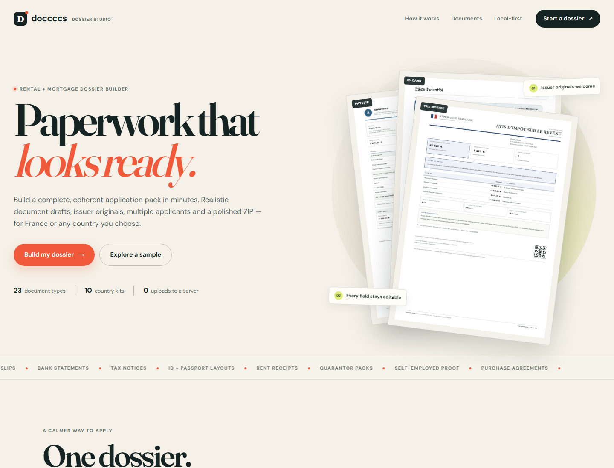

# Doccccs

**The dossier studio.** A local-first alternative to single-purpose KYC document generators, built for rental and mortgage application packs.



## What it does

- **Rental and mortgage dossiers** with the supplied France requirements built in.
- **Country kits** for France, the UK, the US, Germany, Spain, Italy, the Netherlands, Portugal, Belgium and Canada, plus a custom country flow. Every requirement is editable.
- **23 document layouts** rendered as print-ready A4 pages: ID cards, passports, payslips, tax notices, employment documents, bank statements, savings certificates, rent receipts, accommodation certificates, self-employed evidence, purchase agreements, renovation quotes, guarantor undertakings, references and more.
- **Multiple people** with applicant, co-applicant and guarantor scopes, including per-person coverage and separate evidence.
- **Monthly and annual record sets**: generate three payslips, two annual tax notices or a custom run in one operation.
- **Drafts and originals together**: every checklist slot can hold generated drafts and issuer-uploaded files. Originals are stored unchanged.
- **Real ZIP export** with named folders, PDF drafts, untouched original files, a dossier index PDF, a CSV manifest and a README.
- **Local-first**: the dossier is saved in `localStorage`; uploaded originals are stored in IndexedDB. No backend, account, tracking or upload endpoint.

## Run locally

```bash
npm install
npm start
```

Open `http://127.0.0.1:4173`.

## Test

```bash
npx playwright install chromium
npm test
```

The smoke suite covers the landing page, sample dossier, document preview/editor, per-country dossier creation, record-set generation, original uploads and ZIP export.

## Deploy

This is a static app. Serve the repository root with any static host. GitHub Pages can publish from the `main` branch root directly; `.nojekyll` is included.

## Source notes

- `js/data.js` — country kits, requirements, templates and sample data.
- `js/documents.js` — the A4 document renderer.
- `js/export.js` — IndexedDB originals, PDF rendering and ZIP assembly.
- `js/app.js` — builder state, views, editors and interactions.
- `styles.css` / `documents.css` — app and print-document design systems.

Generated pages are editable facsimiles, not issuer-issued originals. The app and ZIP manifest keep that distinction explicit so users can pair drafts with authoritative documents wherever a landlord, lender or authority requires them.

## Third-party code

- [html2canvas](https://html2canvas.hertzen.com/) — MIT
- [jsPDF](https://github.com/parallax/jsPDF) — MIT
- [JSZip](https://stuk.github.io/jszip/) — MIT / GPLv3 dual license
- DM Sans and Fraunces — SIL Open Font License

License texts are included in `vendor/`.
